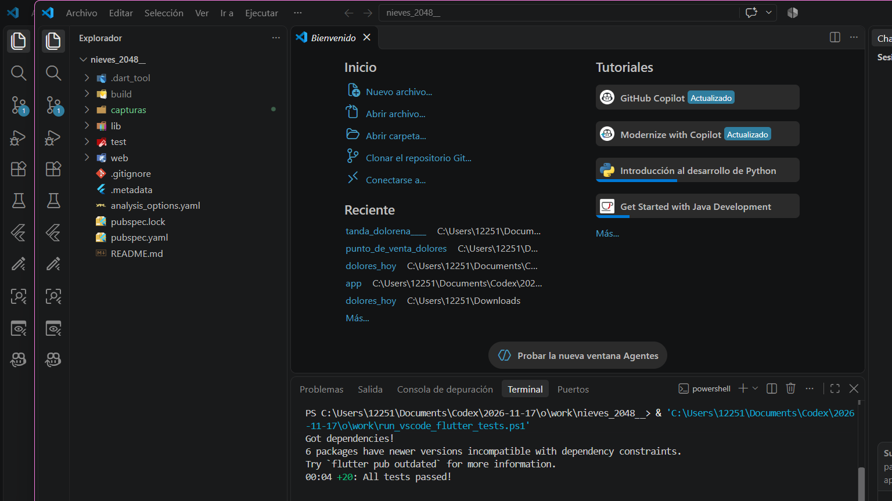

# Nieves 2048

Juego 2048 hecho en Flutter. El jugador mueve fichas, combina números iguales y suma puntos hasta llegar al valor objetivo.

## Cómo ejecutarlo

```bash
flutter pub get
flutter run
```

Para ejecutar las pruebas:

```bash
flutter test
```

## Todas las pruebas

Se ejecutaron las siguientes 20 pruebas:

1. Mover a la izquierda modifica las cuatro filas.
2. Mover a la derecha empuja las fichas al lado contrario.
3. Mover arriba cambia las fichas de cada columna.
4. Mover abajo empuja las fichas hacia la parte inferior.
5. Agregar una ficha coloca exactamente una ficha nueva.
6. No se agrega una ficha cuando el tablero está lleno.
7. Hay movimientos disponibles cuando existe una celda vacía.
8. Hay movimientos disponibles cuando se puede fusionar.
9. No hay movimientos cuando el tablero está lleno y sin fusiones.
10. Compactar una fila quita espacios y mantiene el orden.
11. El jugador gana cuando una celda alcanza el objetivo.
12. No se gana si ninguna celda alcanza el objetivo.
13. Compactar una fila sin espacios no cambia su contenido.
14. Fusionar una fila combina un par de números iguales.
15. Tres números iguales no se fusionan más de una vez.
16. Mover una fila a la izquierda compacta y fusiona.
17. Una fila acomodada indica que no se movió.
18. Un movimiento sin cambios no agrega una ficha.
19. Alcanzar el valor objetivo cambia el estado a ganado.
20. Una serie de movimientos combina fichas y suma puntos.

Resultado final: **20 pruebas aprobadas**.

## Capturas reales de las pruebas

### Fase roja


### Fase verde


