# Nieves 2048

Juego 2048 con sabores de nieves de Dolores Hidalgo, movimientos en cuatro direcciones, puntaje y detección de victoria.

## Cómo ejecutar

1. Instalar las dependencias con `flutter pub get`.
2. Ejecutar las pruebas con `flutter test`.
3. Abrir la aplicación con `flutter run`.

## Trabajo con TDD

En cada fase se siguió el ciclo rojo y verde. La captura roja muestra el error real producido antes de completar el código faltante. La captura verde muestra en Visual Studio Code el código usado para resolver esa fase.

## Fase 1. Compactar una fila

### Fase roja

En esta parte la prueba todavía falla porque falta implementar el código de la fase.

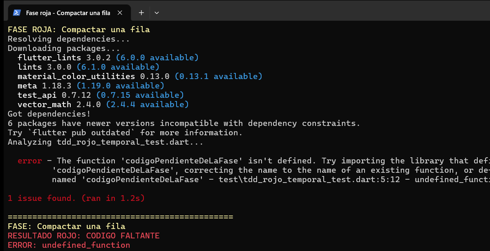

### Fase verde

Después se agrega el código necesario para resolver la prueba y continuar con el proyecto.

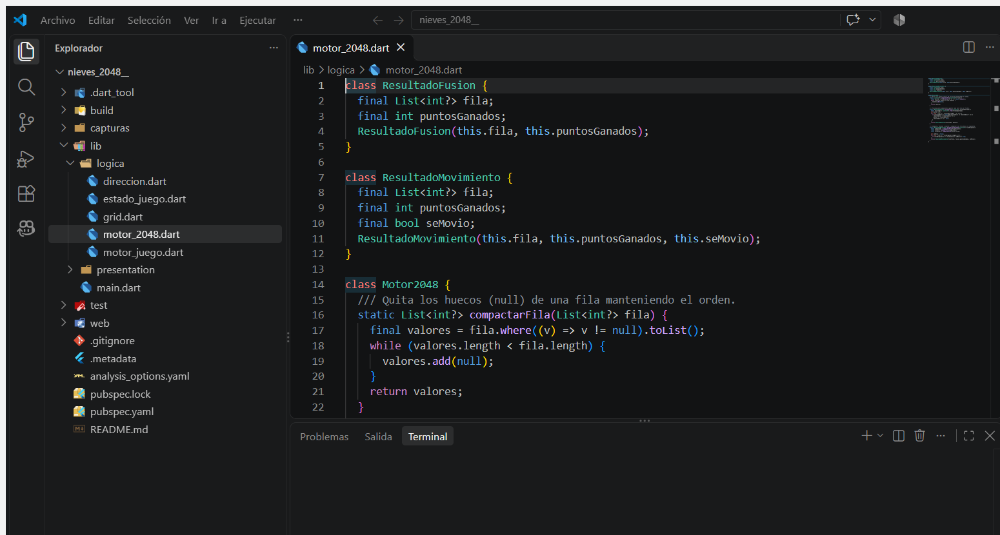

## Fase 2. Fusionar pares iguales

### Fase roja

En esta parte la prueba todavía falla porque falta implementar el código de la fase.

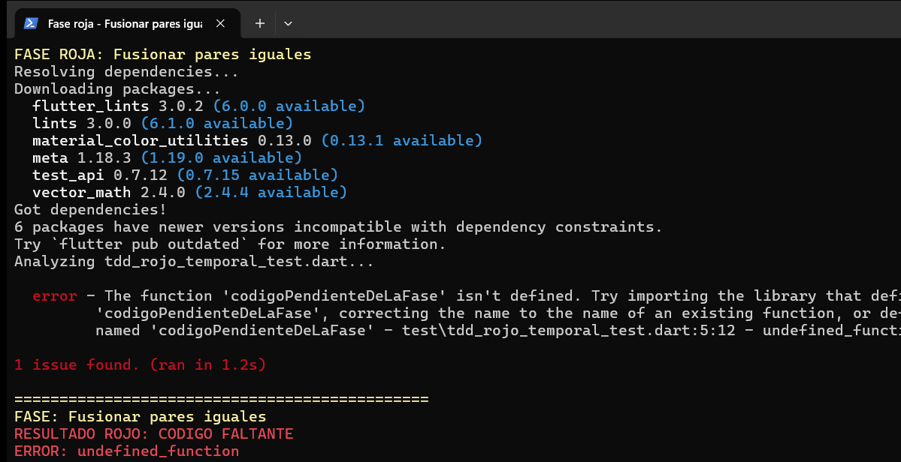

### Fase verde

Después se agrega el código necesario para resolver la prueba y continuar con el proyecto.

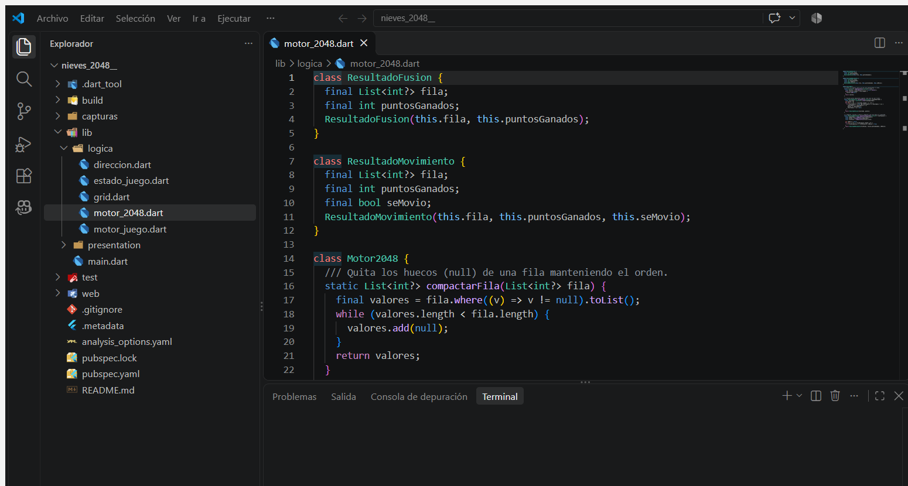

## Fase 3. Mover una fila a la izquierda

### Fase roja

En esta parte la prueba todavía falla porque falta implementar el código de la fase.

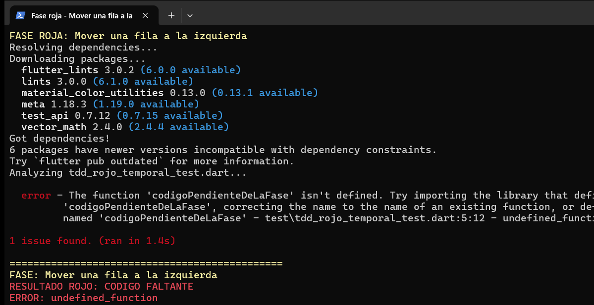

### Fase verde

Después se agrega el código necesario para resolver la prueba y continuar con el proyecto.

## Fase 4. Mover la cuadrícula a la izquierda

### Fase roja

En esta parte la prueba todavía falla porque falta implementar el código de la fase.

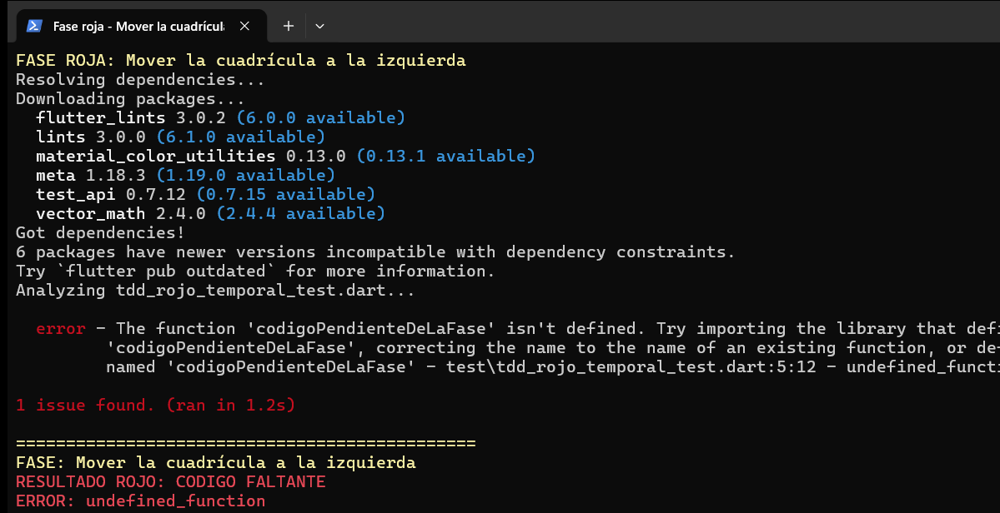

### Fase verde

Después se agrega el código necesario para resolver la prueba y continuar con el proyecto.

## Fase 5. Mover hacia la derecha

### Fase roja

En esta parte la prueba todavía falla porque falta implementar el código de la fase.

### Fase verde

Después se agrega el código necesario para resolver la prueba y continuar con el proyecto.

## Fase 6. Mover arriba y abajo

### Fase roja

En esta parte la prueba todavía falla porque falta implementar el código de la fase.

### Fase verde

Después se agrega el código necesario para resolver la prueba y continuar con el proyecto.

## Fase 7. Agregar una ficha al azar

### Fase roja

En esta parte la prueba todavía falla porque falta implementar el código de la fase.

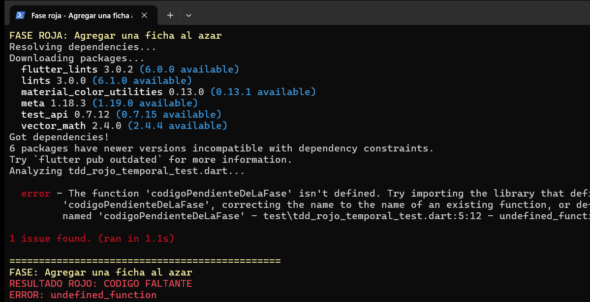

### Fase verde

Después se agrega el código necesario para resolver la prueba y continuar con el proyecto.

## Fase 8. Detectar movimientos disponibles

### Fase roja

En esta parte la prueba todavía falla porque falta implementar el código de la fase.

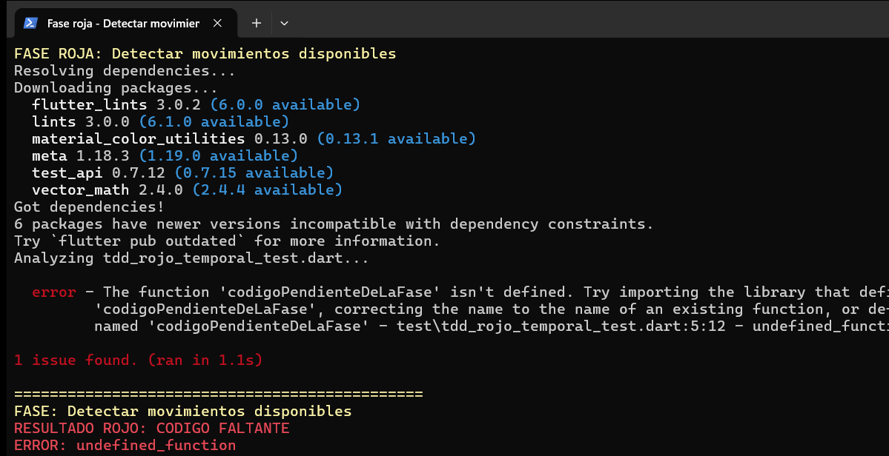

### Fase verde

Después se agrega el código necesario para resolver la prueba y continuar con el proyecto.

## Fase 9. Detectar la victoria

### Fase roja

En esta parte la prueba todavía falla porque falta implementar el código de la fase.

### Fase verde

Después se agrega el código necesario para resolver la prueba y continuar con el proyecto.

## Fase 10. Integrar el motor del juego

### Fase roja

En esta parte la prueba todavía falla porque falta implementar el código de la fase.

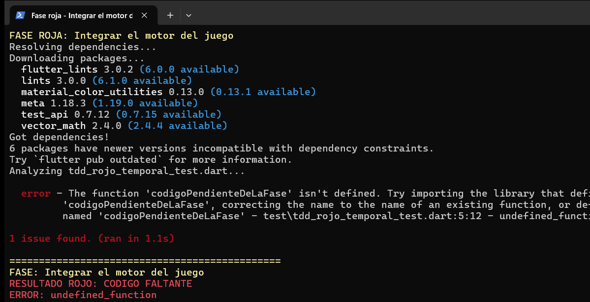

### Fase verde

Después se agrega el código necesario para resolver la prueba y continuar con el proyecto.

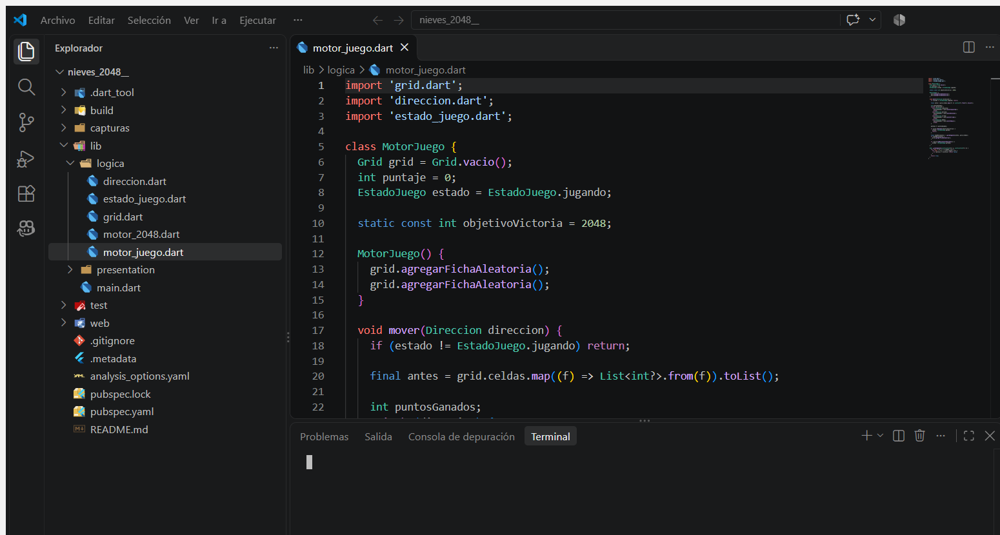

## Aplicación completa

Esta es la aplicación ejecutándose después de terminar las fases.

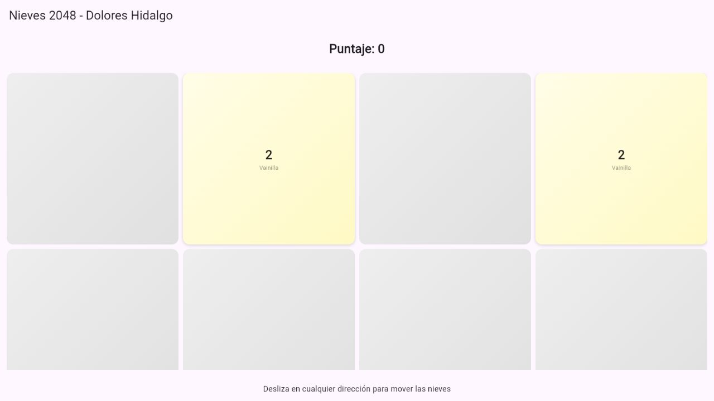

## Resultado

Las fases quedaron documentadas una por una. Cada fase conserva su evidencia roja y verde, y al final se muestra el resultado completo de la aplicación.

