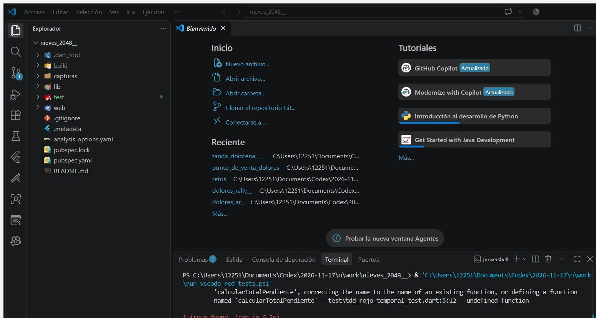

# Nieves 2048

Juego de fusión estilo 2048 con sabores de nieve de Dolores Hidalgo, construido 100% con TDD.

## Cómo usarlo

1. Abre una terminal dentro de esta carpeta (`nieves_2048`).
2. Genera las carpetas de plataforma (android, ios, etc.) sin tocar el código:

       flutter create .

3. Descarga dependencias:

       flutter pub get

4. Corre las pruebas (deben pasar 20 en verde):

       flutter test

5. Ejecuta el juego:

       flutter run

## Estructura

- `lib/logica/` — Dart puro (sin imports de Flutter): motor_2048, grid, direccion, estado_juego, motor_juego
- `lib/presentation/juego_screen.dart` — interfaz con degradados y animaciones
- `test/` — motor_2048_test, grid_test, motor_juego_test

## Evidencia de pruebas

La suite verifica movimientos, fusiones, puntuación, aparición de fichas y estados de victoria o derrota. Resultado: **20 pruebas aprobadas**.

### Ciclo TDD: rojo a verde

La captura roja reproduce de forma controlada el momento previo a implementar una regla; la verde corresponde a la suite final del repositorio.

| 🔴 Prueba que solicita código faltante | 🟢 Implementación terminada |
|---|---|
|  |  |
